# Thean store

Frontend thương mại điện tử **Thean store** (giao diện tiếng Việt), dựng theo bộ thiết kế tham khảo `adidas web Jun 2025` (133 màn hình),
viết bằng **React 19 + Tailwind CSS v4**, sẵn sàng nối backend.

🔗 **Demo:** https://thean-store.vercel.app — tài khoản demo `alex@example.com` / `Password1!`, mã giảm giá `WELCOME15`.

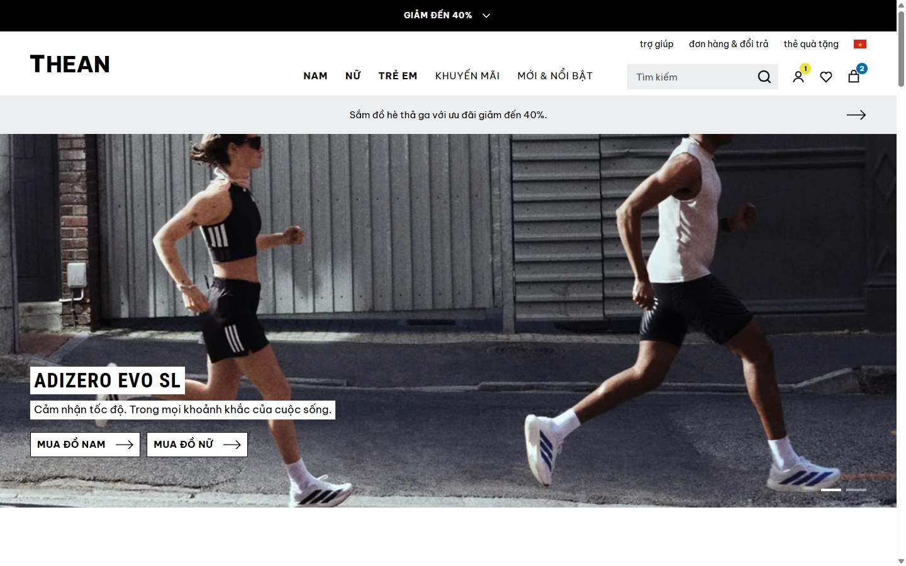

## Ảnh giao diện

| Trang chủ | Danh mục sản phẩm |
|---|---|
| 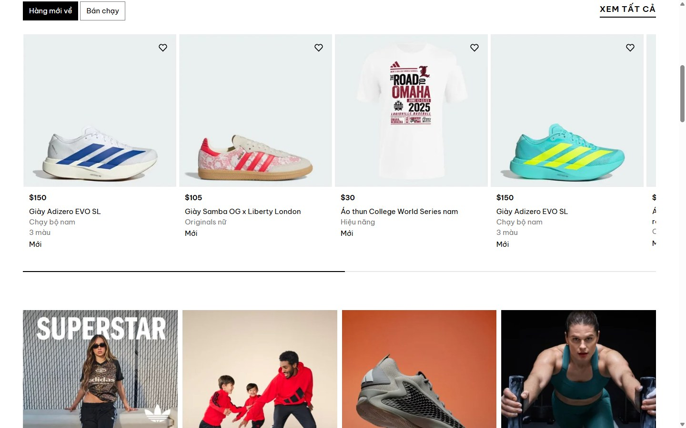 | 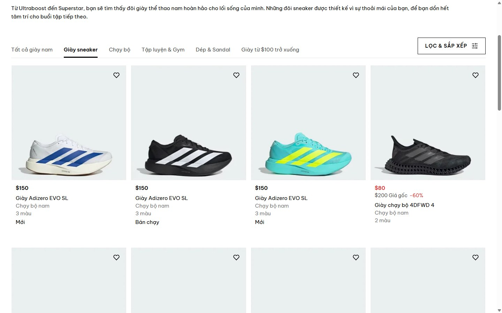 |
| **Chi tiết sản phẩm** | **Giỏ hàng** |
| 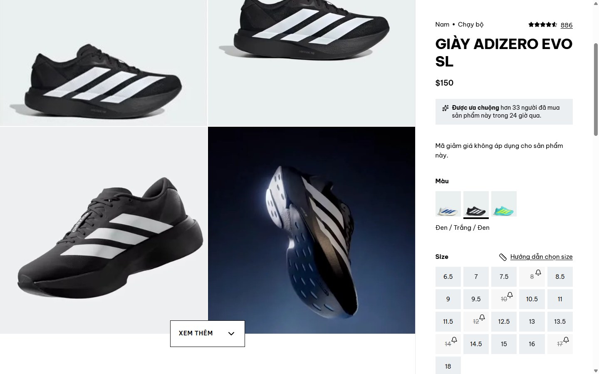 | 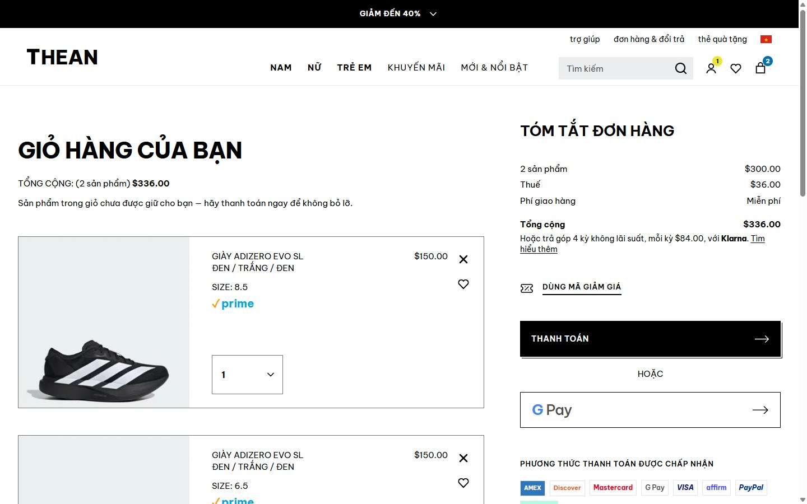 |
| **Thanh toán** | **Tài khoản** |
| 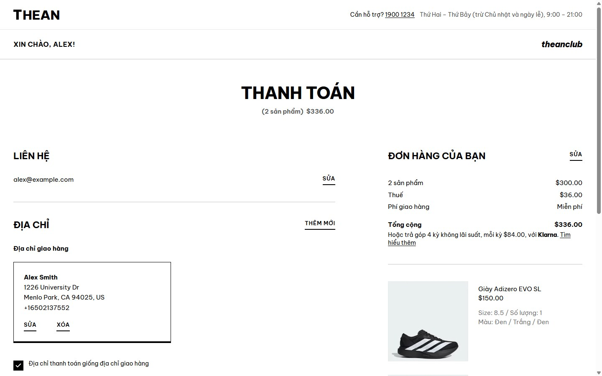 | 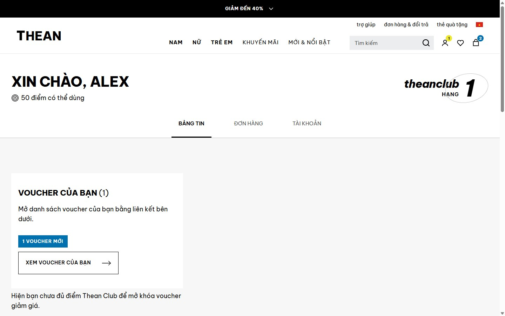 |
| **Đơn hàng** | **Thean Club** |
| 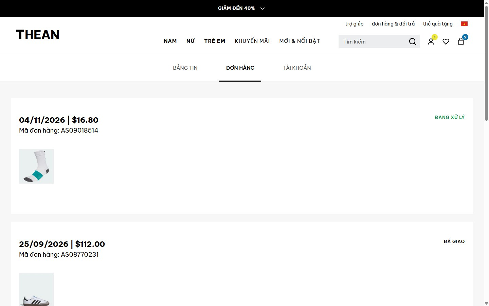 | 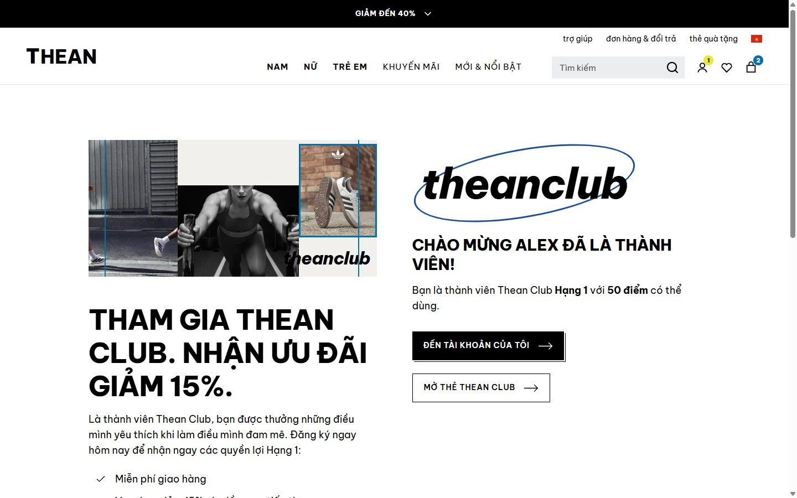 |
| **Giao diện điện thoại** | |
| 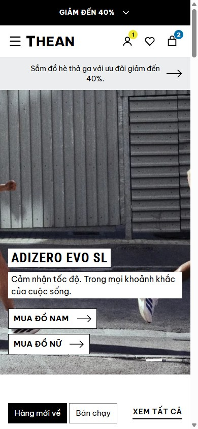 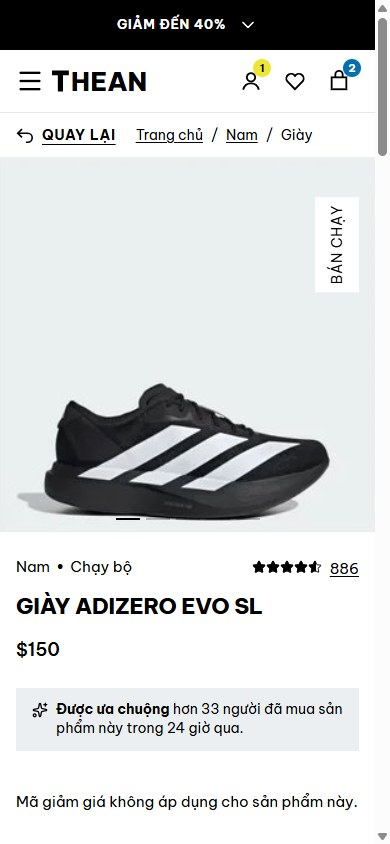 | |

```
adidas-store/
├── docs/
│   ├── DESIGN_SYSTEM.md   ← token màu/chữ/khoảng cách, danh sách component (lập trước khi code)
│   ├── API_CONTRACT.md    ← data model + toàn bộ endpoint backend cần làm
│   ├── SCREEN_MAP.md      ← ảnh thiết kế #n → route → file
│   └── GLOSSARY_VI.md     ← bảng thuật ngữ tiếng Việt dùng thống nhất trên giao diện
├── frontend/              ← ứng dụng React (Vite)
└── backend/               ← (để trống — làm theo docs/API_CONTRACT.md)
```

## Chạy frontend

Yêu cầu Node.js ≥ 20.

```bash
cd frontend
npm install
npm run dev        # http://localhost:5173
npm run build      # build production vào dist/
```

Mặc định app chạy với **mock server trong trình duyệt** (`VITE_USE_MOCK=true` trong `.env`),
dữ liệu (giỏ hàng, đơn hàng, tài khoản…) được lưu ở `localStorage`.

- Tài khoản demo: **alex@example.com / Password1!**
- Mã giảm giá demo: **WELCOME15**
- Reset dữ liệu demo: xoá key `mockdb.v2` trong localStorage (DevTools → Application).

## Kiến trúc frontend

```
frontend/src/
├── styles/index.css        Design tokens (@theme) + utility .ds-* của design system
├── components/
│   ├── ui/                 Design system: Button, Input, Select, Checkbox, Modal, Drawer, Accordion, Tabs,
│   │                       Rating, Price, SizeGrid, ColorSwatches, Carousel, Toaster, icons...
│   ├── layout/             AnnouncementBar, Header, MegaMenu, SearchBox, Footer, layouts, RequireAuth
│   ├── product/            ProductCard, carousel, gallery, filter drawer, size guide, added-to-bag...
│   ├── review/ auth/ club/ account/ home/ cart/ checkout/
├── pages/                  Mỗi route một file (lazy-load)
├── hooks/                  React Query hooks — lớp DUY NHẤT UI dùng để lấy/sửa dữ liệu server
├── api/
│   ├── http.js             HTTP client: gắn token, X-Cart-Id, chuẩn hoá lỗi; chuyển mock ↔ backend thật
│   ├── services/*.js       1 hàm = 1 endpoint trong docs/API_CONTRACT.md
│   └── mock/               Mock server + seed data (sẽ không được bundle khi tắt mock)
├── store/ui.js             State giao diện (zustand): modal đăng nhập, panel adiClub, toast...
├── config/                 Brand, menu, footer, nội dung trang chủ (có thể chuyển sang CMS)
└── utils/                  format tiền/ngày, cn(), storage
```

Luồng dữ liệu: `Page/Component → hooks/useX → api/services/x → api/http → (mock | backend)`.

## Nối backend thật

1. Làm backend theo `docs/API_CONTRACT.md` (base `/api/v1`, JSON, lỗi dạng `{ error: { code, message, fields } }`).
   Có thể đọc `frontend/src/api/mock/server.js` như một bản hiện thực tham chiếu (validation, tính thuế, gộp giỏ hàng khách…).
2. Trong `frontend/.env`:
   ```
   VITE_USE_MOCK=false
   VITE_API_URL=http://localhost:8080/api/v1
   ```
3. Bật CORS cho `http://localhost:5173`, cho phép header `Authorization`, `X-Cart-Id`, `Content-Type`.
4. Khi deploy, thêm domain API vào `connect-src` trong `frontend/vercel.json` (CSP), nếu không trình duyệt sẽ chặn request.

## Deploy (Vercel)

- Root Directory: `frontend`, preset **Vite** (build `npm run build`, output `dist`).
- `frontend/vercel.json` cấu hình SPA rewrite (F5 ở mọi trang không bị 404), header bảo mật (CSP, HSTS, X-Frame-Options…) và cache.
- Không cần biến môi trường: mặc định chạy mock API. Khi có backend, đặt `VITE_USE_MOCK=false` và `VITE_API_URL` trong Vercel → Settings → Environment Variables.

Không cần sửa component nào — chỉ tầng `api/http.js` đổi đích gọi.

## Ghi chú

- Font gốc của adidas là font độc quyền; dự án dùng Barlow / Barlow Condensed / Archivo (mã nguồn mở) để thay thế.
- Ảnh sản phẩm/banner được cắt từ chính các screenshot trong `adidas web Jun 2025/`.
- Tên thương hiệu (Thean store / Thean Club) đặt tập trung ở `src/config/brand.js`, logo ở `src/components/ui/icons.jsx`.
- Ảnh sản phẩm/banner cắt từ screenshot tham khảo vẫn mang logo và tên mẫu của adidas — nên thay bằng ảnh của Thean store trước khi đưa lên mạng.
